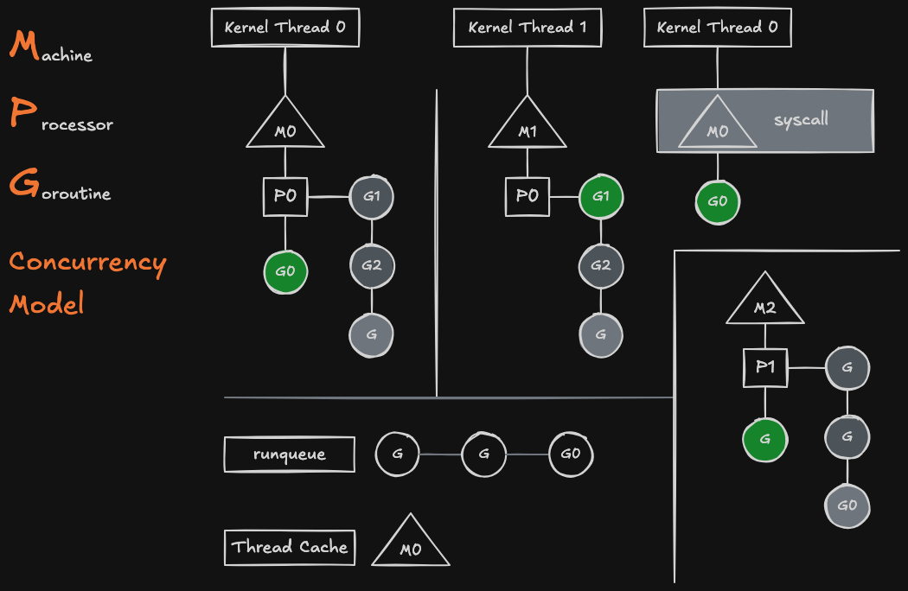

Thoughts on the GMP Model

How scheduling works

1. Each M is permanently bound to one kernel thread. Each P attaches to an M.
2. You may create hundreds or thousands of Gs but have only a few Ps and Ms. Gs line up in a P’s queue first-come-first-served, and the P passes the front G down through M to the kernel thread.
3. On a blocking system call (user, file or process management, unlike plain arithmetic or serialization that stays in user mode), the P detaches. G0 stays bound directly to the blocked M0. P0 picks up another M, either an idle one from the thread cache or a new one, and keeps running G1, G2 and so on. So there can be more Ms than Ps.
4. After the syscall returns, G0 still needs a P. It goes into the global run queue, and M0 goes idle into the thread cache.
5. Ps periodically scan the global queue and claim waiting Gs onto the tail of their own queues. G0 may end up on a different P and a different M.

Kernel threads are provided by the OS. Go programmers can’t use kernel threads directly; they can only create goroutines.
An M is essentially just a struct, and each M is bound 1:1 to a kernel (OS) thread.
When an M blocks on a syscall (non-user), its P hands off to another M. At that point, the number of Ms exceeds the number of Ps.
The number of Ps defaults to the number of CPU cores and can be set explicitly with runtime.GOMAXPROCS.
The P–M binding is dynamic, and so is the G–P binding. As a result, the mapping between a G and a kernel thread is also dynamic.
All Gs are scheduled by the Go runtime scheduler. Every G is treated equally: you can’t assign a priority to a G, and one G can’t affect another G’s lifecycle.

In Go terms, G is a goroutine, M is a machine (an OS thread), and P is a processor (a logical scheduling context that holds the local run queue).
