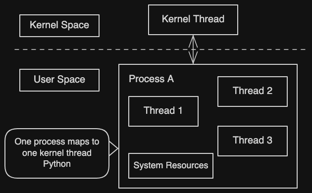
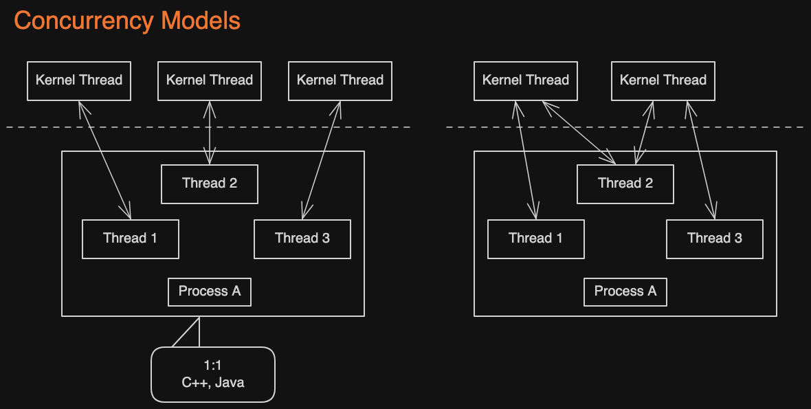

- In Language like python, one process only maps to 1 kernel thread

- Kernel threads are provided by the operating system. Parallelism in any programming language, at the OS level, ultimately comes down to parallelism of kernel threads.
- Multiple threads within the same process share system resources. Process creation, destruction, and context switching are much more expensive than for threads.
- The progression from processes to threads to goroutines is essentially one of increasing resource sharing and continually reducing context-switching overhead.

- For Go, the image inside thread (we refer as goroutine), and each kernel thread map with one or more goroutine

## Coroutines vs. Threads

Goroutine

1. Creation count: You can easily create millions of goroutines without exhausting system resources
2. Memory footprint: Starts with a 4 KB stack that grows and shrinks automatically as execution proceeds
3. Context-switch cost: Saves only 3 registers, which takes about 200 ns
4. Scheduling: Non-preemptive: the Go runtime yields control cooperatively (which means when the goroutine in much clean state that no need to store much data, then it can decide to switch go routine, it store less and make context-switch easier), though from the developer’s view it behaves as preemptive
5. Creation & destruction: Goroutines are managed by the Go runtime, so creating and destroying them is very cheap. It all happens at user level.

Threads

1. Creation count: Typically capped at around 10,000
2. Memory footprint: Stack size must be specified at thread creation and is fixed, typically in MB
3. Context-switch cost: Saves dozens of registers, which takes about 1000 ns
4. Scheduling: Preemptive: when its time slice runs out, a CPU interrupt forcibly schedules it off the CPU, and a lot of state must be saved
5. Creation & destruction: Creating and destroying threads is very expensive because it involves the operating system at kernel level. The usual fix is a thread pool (a thread created, but not destroy but keep it pool for future use).
